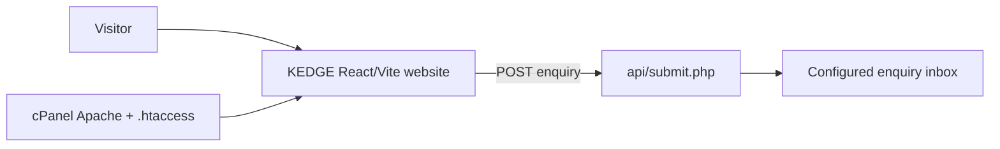
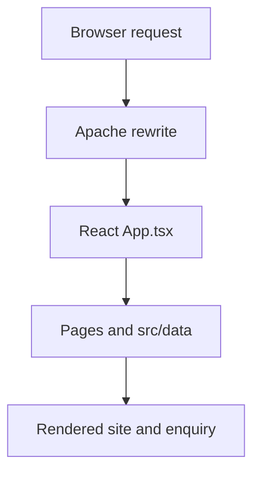
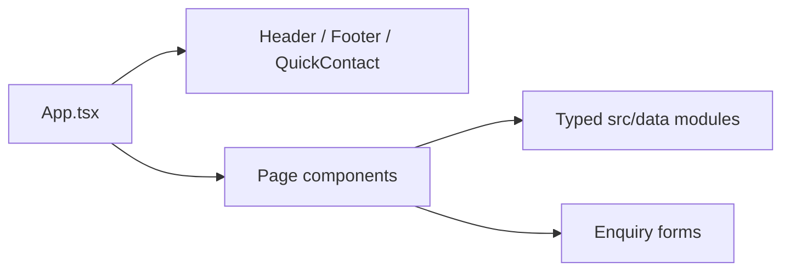
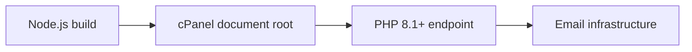

# 1. Executive Summary

KEDGE Insurance Brokers Ltd is a React 19 and TypeScript corporate insurance website built with Vite. It presents services, industries, insights, FAQs, risk-management information, coverage-matrix content, company information and enquiry journeys. The build targets static cPanel hosting: Vite produces `dist/`, Apache rewrites client-side routes to `index.html`, and PHP handles enquiry email delivery. SEO is supported by centralized metadata, sitemap, robots directives and prerendering.

This summary reflects the repository inspected on 2026-10-31. Draft or approval-dependent business content is identified as such.

# 2. Architecture Overview



The system is a static-hosted single-page application with server-assisted enquiry delivery. Visitors load compiled assets from Apache/cPanel. `src/App.tsx` composes page modules and shared layout components. Forms submit to `public/api/submit.php`, which validates input and uses PHP `mail()` to send an enquiry to the configured inbox. The README states that the endpoint does not keep a database copy. The local `server.ts` Express helper is development-only and must not expose its in-memory `/api/submissions` endpoint publicly.

# 3. Processing Pipeline



1. A visitor requests a public route such as the homepage, services, contact, quote, renewal, claims, insights, FAQ or legal pages.
2. Apache serves an asset or rewrites the request to `index.html`.
3. React selects the page through `src/App.tsx` and shared layout components.
4. Pages consume typed data from `src/data/` for services, industries, insights, SEO, company configuration and coverage matrix content.
5. Forms submit to `api/submit.php`; PHP validates and sends mail.
6. The build runs sitemap generation, Vite compilation and prerender generation; SEO scripts validate the outputs.

# 4. Core Components



| Area | Implementation | Responsibility |
|---|---|---|
| Application | `src/App.tsx`, `src/main.tsx` | Path selection, composition and browser entry. |
| Shared layout | `src/components/layout/Header.tsx`, `Footer.tsx`, `QuickContact.tsx` | Navigation, persistent structure and contact controls. |
| Shared UI | `src/components/common/HeroCarousel.tsx`, `CustomerLogoCarousel.tsx`, `BrandLogo.tsx` | Reusable visual and brand components. |
| Pages | `src/pages/*.tsx` | Services, industries, insights, FAQs, contact, quote, renewal, claims and legal pages. |
| Content | `src/data/*.ts`, `src/data/pageSeo.json` | Typed repeatable content, SEO metadata and configuration. |
| Coverage reference | `src/data/coverage-matrix/*.ts` | Insurance classes, products, compulsory insurance and regulations. |
| Build/SEO | `scripts/*.mjs` | Sitemap, prerender and verification workflows. |
| Enquiry | `public/api/submit.php` | Server-side validation and email submission. |

# 5. API Contracts / Message Schemas

The public form contract is implemented by `public/api/submit.php`. The repository confirms server-side validation and email delivery; private inbox values are intentionally omitted.

| Property group | Behaviour | Notes |
|---|---|---|
| Contact identity | Accepted from the enquiry form | Validate and sanitize server-side. |
| Enquiry context | Service, quote, renewal, contact or claims context | Keep labels aligned with visible content. |
| Message details | User-supplied request | Treat as untrusted input. |
| Delivery configuration | Hosting/environment configuration | README identifies `KEDGE_ENQUIRY_EMAIL`; its value is excluded. |
| Persistence | No database record | README says PHP does not retain a server-side copy. |

# 6. Infrastructure & Deployment



Build with Node.js 20+ and npm 10+, upload the contents of `dist/` to the cPanel document root, enable Apache `mod_rewrite`, use PHP 8.1+ for `api/submit.php`, and configure the enquiry inbox through the host-supported mechanism. Test actual mail delivery and SPF/DKIM where applicable; `mail()` acceptance is not final delivery proof. Do not deploy the local `server.ts` helper. No CI/CD configuration was found in the inspected inventory.

# 7. Extension Patterns

Add a focused component under `src/pages/`, compose it with existing layout/common components, update `src/App.tsx`, add metadata through `src/data/seo.ts` and `src/data/pageSeo.json`, add the eligible URL to the sitemap route source, then run `npm run lint`, `npm run build` and `npm run test:seo`. For repeatable content, prefer typed entries in `src/data/`. For customer logos, follow the approval workflow in `README.md` and register approved assets in `src/data/customerLogos.ts`.

# 8. Rules & Anti-Patterns

`AGENTS.md` requires production-grade accessibility, security, maintainability, performance and SEO. Keep company details centralized in `src/data/companyConfig.ts`; never expose credentials, personal data, internal endpoints or private configuration; do not publish customer logos, regulatory claims or legal summaries without verification; preserve working routes and forms; use semantic HTML, keyboard support, visible focus, useful labels, meaningful alt text and reduced-motion support; maintain canonical URLs, sitemap accuracy, robots behaviour and unique metadata; never represent a failed enquiry as successful; keep local submission inspection private.

# 9. Dependencies

| Category | Packages | Purpose |
|---|---|---|
| UI runtime | `react`, `react-dom` | Browser UI rendering. |
| Build | `vite`, `@vitejs/plugin-react`, `@tailwindcss/vite`, `tailwindcss` | Bundling and styling. |
| Type checking | `typescript`, React/Node/Express type packages | Static analysis and contracts. |
| UI utilities | `lucide-react`, `motion` | Icons and motion interactions. |
| Development server | `express`, `tsx`, `dotenv` | Local helper server and TypeScript execution. |
| Optional AI dependency | `@google/genai` | Present in manifest; runtime usage needs verification. |
| Build support | `autoprefixer`, `esbuild` | CSS compatibility and build tooling. |

# 10. Code Structure

```text
src/{App.tsx,main.tsx,index.css}
src/pages/                         route-level components
src/components/{common,layout}/    reusable and layout components
src/data/                          typed content and SEO configuration
src/data/coverage-matrix/           insurance and regulatory data
src/types/                          shared TypeScript contracts
src/assets/                         brand and photographic assets
public/{api,robots.txt,sitemap.xml} endpoint and crawler files
scripts/                            sitemap, prerender and verification scripts
docs/                               documentation and diagrams
```

## Verification status

## 11. Final Performance and Deployment Readiness Audit

Audit date: 2026-10-31. No production systems were changed.

### Status summary

| Area | Status | Evidence |
|---|---|---|
| Prerendering and React mounting | **VERIFIED** | Prerendered HTML is a semantic fallback, not a React-compatible tree. `createRoot()` intentionally replaces it; `hydrateRoot()` is not appropriate. Fresh browser checks showed one interactive page after mount, with no duplicate visible content. |
| Homepage hero prioritisation | **VERIFIED** | The hero is preloaded only on `/`, and the first carousel image is eager/high priority. A fresh Contact page no longer reported the unused homepage hero preload. |
| CLS remediation | **PARTIALLY VERIFIED** | Images have reserved dimensions, the Suspense fallback has stable height, and Google font requests were reduced with `display=swap`. Fresh Lighthouse CLS measurement was unavailable. |
| LCP/TBT measurement | **BLOCKED** | Lighthouse CLI 11.19.0, a system Edge/Chrome executable, and a browser Lighthouse interface were unavailable. No after-score is claimed. |
| Forms and PHP contract | **PARTIALLY VERIFIED** | Contact, Quote and Renewal payload contracts and server validation were inspected; empty Contact submission produced field-level errors. PHP syntax/mail delivery could not be executed because PHP is not installed locally and no real enquiry was authorised. |
| cPanel package | **VERIFIED** | `dist/` contains the 21 sitemap routes, route metadata, `robots.txt`, `sitemap.xml`, `.htaccess`, assets, and a byte-matching `api/submit.php`. |

### Lighthouse comparison

The supplied baseline was Desktop: Performance 62, Accessibility 93, Best Practices 100, SEO 100, LCP 1.5 s, TBT 200 ms, CLS 0.54; Mobile: Performance 20, Accessibility 93, Best Practices 100, SEO 100, LCP 6.3 s, TBT 2,140 ms, CLS 0.51. After measurements are **BLOCKED**, so FCP, Speed Index, LCP, TBT, CLS and category scores are not reported as improved. The built JavaScript entry remained approximately 331.56 kB (103.61 kB gzip); the hero image is approximately 258.83 kB. These are build facts, not Lighthouse outcomes.

The remaining performance risks are the large shared entry bundle and main-thread startup work, plus Google font swapping and image transfer on constrained mobile connections. These are code/build indicators; their exact Lighthouse attribution remains unverified without the requested runner.

### Form integration

Production Contact and Renewal requests use `/api/submit.php`; local development retains `/api/contact` and `/api/renewal`. The endpoint accepts `contact`, `quote` and `renewal`, validates required fields, email, phone, lengths, category values and privacy consent, returns 422 for invalid payloads, 503 for missing delivery configuration or mail failure, and 200 with a generated reference after `mail()` accepts the message. The recipient is read from `KEDGE_ENQUIRY_EMAIL`; no credential is exposed in frontend code. Actual mailbox delivery is **PARTIALLY VERIFIED** and requires an authorised staging or production-safe test.

### Deployment manifest

Upload the contents of `dist/` to the cPanel document root, including:

- the 21 sitemap-listed prerendered HTML routes, plus `services/index.html` for DirectoryIndex compatibility;
- `.htaccess`, `robots.txt`, and `sitemap.xml`;
- `assets/`, `favicon.svg`, and all referenced compiled JavaScript, CSS, image and font assets;
- `api/submit.php`.

Do not upload source files, `node_modules/`, `.env` files, development servers, credentials or repository metadata. The generated rewrite rules pass `/api/` through, map clean public routes to generated HTML, pass existing files/directories through, and use `index.html` only as the final SPA fallback. No apex-to-www redirect was added; hosting ownership of that redirect remains a deployment prerequisite.

### Regression evidence

`npm run build`, `npm run lint`, `npm run test:seo`, and `git diff --check` completed successfully. SEO verification confirmed 21 canonical URLs and 21 prerendered public routes with metadata, structured data and semantic HTML. Browser checks covered Homepage, About, Motor, Contact, an unknown route, internal navigation/back navigation, the Renewal route, empty Contact validation, and the 390px mobile navigation. No valid enquiry was submitted. The build emitted only the existing Vite warning about `__dirname` in `vite.config.ts` and Git line-ending warnings; neither caused a failed check.

**PARTIALLY VERIFIED:** This document reflects the inspected repository structure, manifest, README and project directive. Diagram and Word exports require tool execution. Hosting mail delivery, external approvals, browser rendering and deployment are outside this repository inspection.
